<div align="center">



<br/>

[](https://github.com/T-Einstein/TIVIDY_214/actions/workflows/ci.yml)


</div>


<div align="center">
<br/>


<br/>


<br/>


<br/><br/>
</div>


<div align="center">

[](https://skillicons.dev)

| Layer | Technology | Version |
|---|---|---|
| Language | C++ | 11 |
| Build System | CMake + FetchContent | 3.16+ |
| Testing | GoogleTest | Auto-fetched |
| Memory Analysis | Valgrind | 3.18 |
| Containerisation | Docker + Compose | Latest |
| CI/CD | GitHub Actions | Ubuntu 22.04 |
| Database | SQLite | 3.x |

</div>


<details>
<summary><b> Build & Run Locally (click to expand)</b></summary>

```bash
# 1. Configure the build system
cmake -B build -DCMAKE_BUILD_TYPE=Debug

# 2. Compile the project and test suite
cmake --build build -- -j$(nproc)

# 3. Run the main application
./build/bin/tividy_app

# 4. Run all unit tests
./build/bin/tividy_tests

# 5. Check for memory leaks
valgrind --leak-check=full --show-leak-kinds=all --error-exitcode=1 ./build/bin/tividy_tests
```

</details>

<details>
<summary><b>Build and run with Docker (click to expand)</b></summary>

```bash
# Build the application
sudo docker compose up --build

#Run the application
sudo docker compose run --rm --build tividy_app

# Run unit tests inside the container
sudo docker compose run --rm tividy_app ./build/bin/tividy_tests

# Run Valgrind memory check inside the container
sudo docker compose run --rm tividy_app valgrind --leak-check=full ./build/bin/tividy_tests
```

While the console application is running, add a valid `.json` blueprint directly
to the host `src/` directory and enter `r` at the scenario menu. The menu
rescans `src/` without restarting the application. Docker mounts the host
directory at `/app/src`, so the new file is immediately available inside the
running container. Invalid files are reported as warnings and are not listed.

</details>


Every push to any branch and every Pull Request into `dev` or `main` triggers our automated **GitHub Actions** pipeline (job: `build-and-test`) running on an Ubuntu 22.04 cloud runner.

| Check | Tool | Failure = |
|---|---|---|
| Compilation | GCC · `-Wall -Wextra -Werror -std=c++11` | Build blocked |
| Unit Tests | GoogleTest · `ctest` | Merge blocked |
| Memory Leaks | Valgrind · `--error-exitcode=1` | Merge blocked |

> ✅ Green checkmark = all clear. &nbsp; ❌ Red X = PR is physically locked until fixed.


To ensure nobody breaks each other's code, we follow a strict **feature-branch workflow**: each member implements their assigned design pattern on their own `feat/<feature-name>` branch.

```
main         ← Tagged milestone releases only (protected)
 └─ dev      ← Integration branch, all PRs merge here (protected)
      ├─ feat/composite-visitor
      ├─ feat/command-memento
      ├─ feat/facade-observer
      └─ feat/<your-pattern>
```

<details>
<summary><b> Daily Git Workflow (click to expand)</b></summary>

```bash
# 1. Start from an up-to-date dev
git checkout dev
git pull origin dev

# 2. Create your feature branch
git checkout -b feat/your-pattern-name

# 3. Work, then commit (always commit before pulling updates from dev)
git add .
git commit -m "feat(pattern): implement XYZ"

# 4. Pull latest dev before pushing (IMPORTANT)
git pull origin dev    # resolve any conflicts first

# 5. Verify tests pass locally before pushing
cmake --build build && ./build/bin/tividy_tests

# 6. Push, then open a Pull Request into dev on GitHub
git push origin feat/your-pattern-name
```

> ⚠️ **Always pull before you push.** Skipping this is the #1 cause of merge conflicts on shared files like `Composite.h`.

</details>


Our CMake setup features **automatic test discovery**: any `.cpp` file inside `tests/` is registered automatically, so just create the file (e.g., `tests/test_builder.cpp`).

```cmake
file(GLOB TEST_SOURCES "tests/*.cpp")
```

<details>
<summary><b> Test template — Arrange · Act · Assert (click to expand)</b></summary>

```cpp
#include <gtest/gtest.h>
#include "YourHeader.h"

TEST(MySuiteTest, DescribesExpectedBehavior) {
    // Arrange — set up objects
    MyClass obj("example");

    // Act — perform the operation
    auto result = obj.doSomething();

    // Assert — verify outcome
    EXPECT_EQ(result, expectedValue);
    ASSERT_TRUE(result.isValid()); // stops test immediately if false
}
```

</details>


```text
TIVIDY_214/
├── .github/
│   └── workflows/
│       └── ci.yml              ← GitHub Actions pipeline (job: build-and-test)
├── include/                    ← All public headers (.h)
│   ├── Composite.h
│   ├── Command.h
│   ├── Memento.h
│   └── ...
├── src/                        ← Production source files (.cpp)
│   ├── composite/
│   ├── command/
│   ├── Facade/
│   ├── Memento/
│   └── main.cpp
├── tests/                      ← GoogleTest suites (auto-discovered)
│   ├── test_smoke.cpp          ← Smoke test verifying test runner and CI
│   ├── test_composite.cpp
│   ├── test_command.cpp
│   └── ...
├── docs/                       ← Architecture research, diagrams, and proposals
├── CMakeLists.txt              ← Root build system
├── Dockerfile                  ← Container build definition
├── docker-compose.yml          ← Compose service config
├── .gitignore                  ← Excluded build files and artifacts
└── README.md
```


